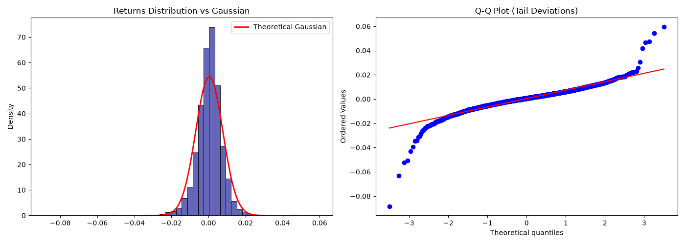
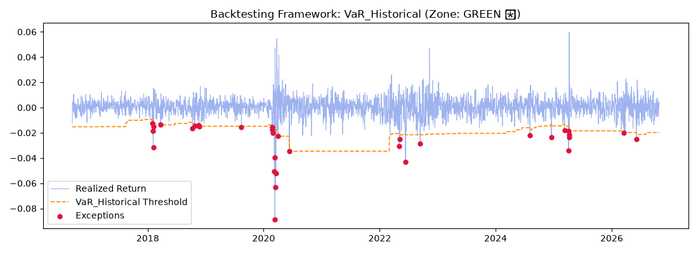
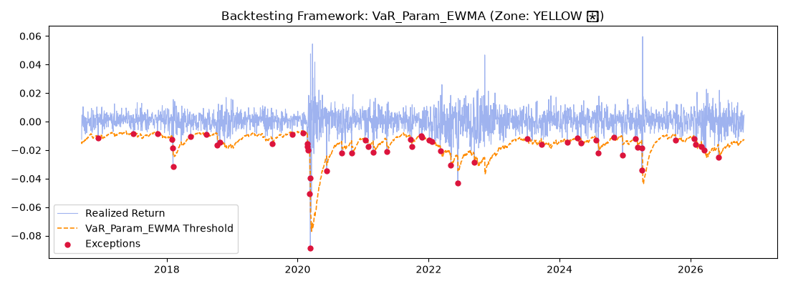
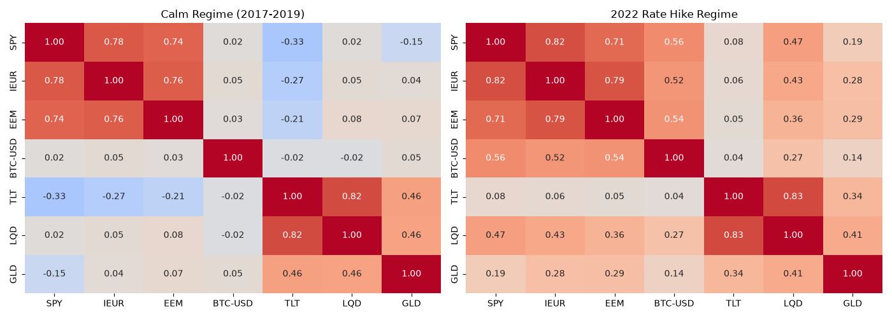

# Quantitative Market Risk & Portfolio Framework

##  Core Research Question
**"How much can we statistically trust Value at Risk (VaR), and where does its structural architecture fail under severe macro regimes?"**

Instead of treating risk as an isolated calculation, this project builds a dynamic rolling risk engine on a multi-asset **60/40-style portfolio** and evaluates five VaR methodologies with formal statistical backtests. It then checks the two main stress episodes in the sample (**COVID-19 crash, 2020** and **Fed rate-hike cycle, 2022**) against horizon-consistent VaR bounds and a deterministic macro shock, to show where rolling statistical models work, where they fail, and why.

---

##  Portfolio & Repository Structure

All parameters live in `config.py`.

| Bucket | Asset | Weight |
| :--- | :--- | :---: |
| Growth (60%) | SPY | 30% |
| | IEUR | 15% |
| | EEM | 10% |
| | BTC-USD | 5% |
| Defensive (40%) | TLT | 15% |
| | LQD | 15% |
| | GLD | 10% |

Weights are fixed and implicitly rebalanced daily (portfolio return = weighted sum of daily simple returns).

```
├── config.py              # tickers, weights, window, confidence level, seed, paths
├── run_pipeline.py        # runs the full flow end-to-end
├── requirements.txt
├── sources/
│   ├── data_loader.py     # download + freeze prices, portfolio returns
│   ├── eda_analysis.py    # moments, Jarque-Bera, normality & correlation plots
│   ├── metrics.py         # rolling VaR / ES engines
│   ├── backtesting.py     # Kupiec, Christoffersen, joint test, Basel zones, plots
│   └── stress_testing.py  # horizon-scaled historical stress + hypothetical shock
├── data/                  # raw_prices.csv (frozen), rolling_risk_results.csv
└── plots/                 # all generated figures
```

### How to run
```bash
pip install -r requirements.txt
python run_pipeline.py
```
The first run downloads prices from Yahoo Finance and **freezes** them in `data/raw_prices.csv`; every later run reuses that file, so results are reproducible. Delete the file to refresh the data. The Monte Carlo engines use `RANDOM_SEED = 42`.

**Data used in this README:** prices frozen at 27 Oct 2026. Ingestion is set to start in 2007, but BTC-USD only exists from **Sep 2014**, so the effective sample is **2014-09-18 → 2026-10-27 (3,045 daily returns)**. This sample does **not** include the 2008 financial crisis.

---

##  Methodology

The rolling engine uses a **500-day window** and a **99% confidence level**. Risk for day *t* uses only data up to *t-1* (no look-ahead). The first 500 days are the estimation burn-in, so the backtest covers **2,545 trading days (13 Sep 2016 → 27 Oct 2026)**, with **25.45 violations expected** at 99%.

1. **Historical Simulation:** empirical 1% quantile of the last 500 portfolio returns; no distributional assumption. Also produces Expected Shortfall (ES).
2. **Parametric Static (Variance-Covariance):** Normal distribution with the 500-day mean and standard deviation of portfolio returns.
3. **Parametric EWMA (RiskMetrics):** Normal distribution with exponentially weighted volatility (λ = 0.94), so recent shocks count more.
4. **Monte Carlo Multivariate Normal:** 20,000 draws from the rolling **asset-level** mean vector and covariance matrix, projected onto the portfolio weights.
5. **Monte Carlo Student's t:** a Student's t distribution fitted by MLE to the **portfolio-level** 500-day returns, then 20,000 draws. Also produces ES.

> Note: models 4 and 5 are not like-for-like. Model 4 is multivariate at asset level; model 5 is univariate at portfolio level.

---

##  Results

### 1. The Normality Illusion (EDA, full sample)



Portfolio log returns reject Gaussianity (**Jarque-Bera p-value ≈ 0.0000**), with **excess kurtosis ≈ 15.39** and **skewness ≈ -0.87**. The Q-Q plot shows heavy tails on both sides, much heavier on the loss side. Models built on a Normal distribution are therefore structurally exposed in the tails.

### 2. Backtesting at 99% VaR (Sep 2016 → Oct 2026, 2,545 days)

| Model | Violations (expected 25.45) | Per 250 days | Basel Zone | Kupiec p | Independence p | Joint (cond. coverage) p |
| :--- | :---: | :---: | :---: | :---: | :---: | :---: |
| Historical | 33 | 3.24 | 🟢 Green | 0.1503 | <0.0001 | <0.0001 |
| Parametric Static | 45 | 4.42 | 🟡 Yellow | 0.0004 | <0.0001 | <0.0001 |
| Parametric EWMA | 55 | 5.40 | 🟡 Yellow | <0.0001 | 0.0363 | <0.0001 |
| MC Multivariate Normal | 46 | 4.52 | 🟡 Yellow | 0.0002 | <0.0001 | <0.0001 |
| MC Student's t | 34 | 3.34 | 🟢 Green | 0.1052 | 0.0001 | 0.0001 |

*Basel zones use a simplification: total violations are rescaled to a 250-day window (≤4 Green, ≤9 Yellow, otherwise Red). The official zones are defined through binomial probabilities on exactly 250 days, so treat the colours as indicative. Kupiec, Independence and Joint tests are the formal checks.*

**Reading the table**
*   **Frequency (Kupiec):** only **Historical** and **MC Student's t** pass. The three Normal-based models (Static, EWMA, MC Normal) are rejected because they produce about 45–55 violations against 25 expected, which is the signature of thin-tail assumptions on fat-tailed data.
*   **Independence (Christoffersen):** **no model passes**. EWMA is the least clustered (p = 0.036, still below 0.05).
*   **Joint test:** every model is rejected, including the two that pass Kupiec. Getting the *number* of violations right is not enough.

Example backtest charts (all five are in `plots/`):




### 3. The Volatility Clustering Problem
*   **Clustering is visible on the charts.** Violations bunch up in Feb–Mar 2020 and again in the spring-2025 sell-off for every model.
*   **EWMA trade-off.** EWMA has the *worst* frequency (55 violations) but the *best* independence p-value. It reacts quickly to volatility, so its threshold follows the market and exceptions are less clustered, but it still uses a Normal quantile, so it keeps breaching in ordinary fat-tail days. Speed of adaptation and tail shape are separate problems; neither model solves both.
*   **Window memory.** The Historical VaR threshold steps up only after the COVID crash and then stays high for about two years, because a 500-day window gives a calm day from 2 years ago the same weight as yesterday's panic. This is consistent with the lagged, clustered exceptions, but the window effect was not isolated in a separate experiment.

---

##  Stress Testing (horizon-consistent)

Comparing a **1-day** VaR with a **multi-week or multi-month** loss is an apples-to-oranges comparison. Each historical episode is therefore compared with the average daily 99% Historical VaR over the sample (**≈ 2.00%**) scaled by the square-root-of-time rule, VaR × √T.

| Scenario | Length | Cumulative loss | Time-scaled 99% VaR | Reading |
| :--- | :---: | :---: | :---: | :--- |
| **COVID-19 crash** (19 Feb – 23 Mar 2020) | 24 days | **-20.93%** | **9.81%** | **Tail event**: loss is ~2.1x the scaled VaR |
| **2022 rate-hike cycle** (full year) | 251 days | **-20.48%** | **31.72%** | **Within bounds**: not a tail event in VaR terms |
| **Hypothetical severe shock** | n/a | **-24.20%** | deterministic | Harsher than both historical episodes |

*   For COVID, using the VaR actually in force on 19 Feb 2020 (≈ 1.37% daily, ≈ 6.73% scaled to 24 days) the loss is about 3.1x the bound.
*   **Hypothetical shock:** equities (SPY, IEUR, EEM) -25%, BTC -40%, GLD +8%, a +200 bp rate shock for TLT (duration 16.0, convexity 3.2; ≈ -31.9%) and +200 bp rates plus +150 bp credit spread for LQD (duration 8.5; ≈ -29.75%).
*   **Caveats:** the √T rule assumes independent returns, which volatility clustering violates. Historical losses compound the daily-rebalanced portfolio return. Bond shocks are duration/convexity approximations (no convexity on LQD).

### 2022: a diversification failure, not a VaR tail event
The 2022 loss of about -20% was spread over a whole year, so it sits inside the horizon-scaled VaR bound. The real damage came from the hedge failing. In the correlation matrices:



*   **SPY/TLT** daily correlation moved from **-0.33** (2017–2019) to **+0.08** (2022): the stock–bond hedge vanished.
*   Equities became more tied to other assets: SPY/BTC rose from **0.02 to 0.56** and SPY/LQD from **0.02 to 0.47**.
*   TLT/LQD stayed highly correlated (**0.83**), so the bond sleeve fell together under the rate shock.

---

##  Conclusions

1.  **Fat tails matter.** Returns are strongly non-Gaussian, and the Normal-based models (Static, EWMA, MC Normal) underestimate tail frequency by roughly 1.8–2.2x.
2.  **Only Historical and Student's t get frequency right**, yet **all five models fail independence and the joint test**: VaR can be right on average and still wrong *when it matters*.
3.  **VaR and stress testing answer different questions.** VaR describes ordinary-regime loss frequency; deterministic stress tests and diversification checks capture regime shifts like COVID (tail event) and 2022 (correlation breakdown), which a rolling VaR does not flag on its own. This supports the regulatory practice of using statistical risk measures together with stress testing (note that Basel's FRTB internal-models framework has moved from 99% VaR to 97.5% ES).

---

##  Limitations

*   The sample starts in Sep 2014 (BTC constraint) and has no 2008-style crisis.
*   MC Student's t is fitted per window on portfolio returns; the MLE fit is sometimes unstable (visible as jagged spikes in its threshold chart, and extreme MC-t ES values in some windows). **ES is computed but not backtested.**
*   Models 4 and 5 differ in construction (asset-level vs portfolio-level), so their comparison is not strictly like-for-like.
*   Basel zones rely on 250-day rescaling (see note under the backtesting table).
*   Square-root-of-time scaling assumes i.i.d. returns and uses the sample-average daily VaR.
*   Fixed weights with implicit daily rebalancing; no transaction costs and no liquidity modelling.

---

##  Requirements
`yfinance`, `pandas`, `numpy`, `scipy`, `matplotlib`, `seaborn` (see `requirements.txt`).
